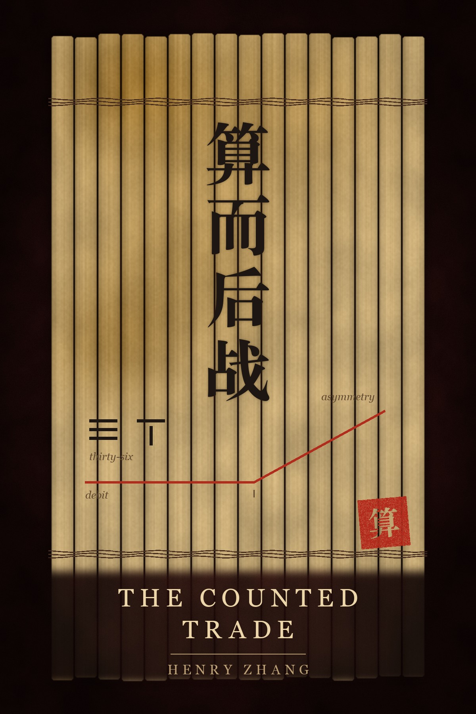

# The Counted Trade · 算而后战

**The Thirty-Six Stratagems, read for the buyer of asymmetric options** · 《三十六计》期权买方读本

This is the buyer's book. [The Art of Options War](https://github.com/henryzhangpku/art-of-options-war) reads the seller of the defined-risk credit spread: the trader paid to hold a line, who wins most engagements and can be ruined by one. The Counted Trade stands on the other side of the same trade. The buyer pays a debit, and the debit is the whole risk; his upside is the asymmetry he paid for. Time is his enemy, volatility his price, and a catalyst his only ally. His art is choosing which mispricing, timing which dated event, paying the right price, and committing correctly — conviction in the rules and the thesis, a staged ladder, and a size small enough that one loss is trivial. The thirty-six stratagems come in six sets of six. A stratagem is a trick played on an enemy, and in trading the enemy most often tricked is yourself. Before any option or stock trade, five sentences must each be sayable in one: the edge, the catalyst, the max loss, the time stop, and the breakeven win rate. A trade that cannot say all five is a hope trade. A second voice runs beside the stratagems: Jamie Mai, a buyer of cheap convexity, as described in Jack Schwager's *Hedge Fund Market Wizards* and Michael Lewis's *The Big Short*. The book follows his practice as a thread and gives the counterweight equal weight: a pre-registered test of the mechanical version of his method failed. The quiet stock was only his entry condition; the event was his edge. A screen cannot borrow his eye.

Numbered aphorisms with a commentary, in the manner of the old Chinese text. No forecasts, no signals, no performance claims.

Both editions were written by hand. The Chinese is not a translation of the English, and the English is not a translation of the Chinese — they are the same book written twice.

## Read it

| | English | 中文 |
|---|---|---|
| Contents | **[Start here](en/README.md)** | **[从这里开始](zh/README.md)** |
| One file | [The whole book](en/the-whole-book.md) | [全书单页](zh/the-whole-book.md) |
| Prologue | [Before the Count](en/prologue.md) | [算之前](zh/prologue.md) |

## The six sets

Each set opens with a chapter; the links below are the first of its six.

| Set | Subject | Opens with | 开篇 |
|---|---|---|---|
| **I · Winning** 胜战计 | The count before the battle | [1. Cross the Sea Under Camouflage](en/chapter-01.md) | [1. 瞒天过海](zh/chapter-01.md) |
| **II · Confronting the Enemy** 敌战计 | Reading the other side's price | [7. Create Something From Nothing](en/chapter-07.md) | [7. 无中生有](zh/chapter-07.md) |
| **III · Attack** 攻战计 | The funnel | [13. Beat the Grass to Startle the Snake](en/chapter-13.md) | [13. 打草惊蛇](zh/chapter-13.md) |
| **IV · Confused Situations** 混战计 | Risk when the field is chaos | [19. Remove the Firewood From Under the Pot](en/chapter-19.md) | [19. 釜底抽薪](zh/chapter-19.md) |
| **V · Gaining Ground** 并战计 | Testing without fooling yourself | [25. Replace the Beams With Rotten Timbers](en/chapter-25.md) | [25. 偷梁换柱](zh/chapter-25.md) |
| **VI · Desperate Situations** 败战计 | The drawdown | [31. The Beauty Trap](en/chapter-31.md) | [31. 美人计](zh/chapter-31.md) |

The order is the argument: count before the battle, read the other side's price, pass the funnel, hold the max loss in chaos, test without fooling yourself, and learn to leave the field.

## Read one chapter a day

Six sets of six: thirty-six chapters, six weeks at one a day. Then read them again in the sets' order. The first pass teaches the count; the second is where the sets begin to argue with each other, and where the buyer's own habits come into view.

## A note on what this is

This book is education, not advice. It contains no recommendations for you personally, no signals and no promises. Options can lose money faster than stock. A long option can lose its entire premium, and a debit spread can lose its whole debit; that debit can still be more than you can afford, and a run of losses can still end an account. Nothing here is a performance claim; where the text names a number, it is either arithmetic you can check on paper or a finding of a named, pre-registered study, given with its flaws.

## The author

Henry Zhang · 张恒, [officialhenryzhang.com](https://www.officialhenryzhang.com) · [LinkedIn](https://www.linkedin.com/in/henryzhang99/) · [GitHub](https://github.com/henryzhangpku)

- **The companion books** — [The Art of Options War · 期权兵法](https://github.com/henryzhangpku/art-of-options-war): Sun Tzu's thirteen chapters, read for the premium seller and the defined-risk credit spread. [The Options Underwriter · 期权承保](https://github.com/henryzhangpku/options-underwriter): the same trade read as insurance — policy, price, reserves, claims, catastrophe. Both are free.
- **Notes and letters** — [henryzhang.substack.com](https://henryzhang.substack.com/)
